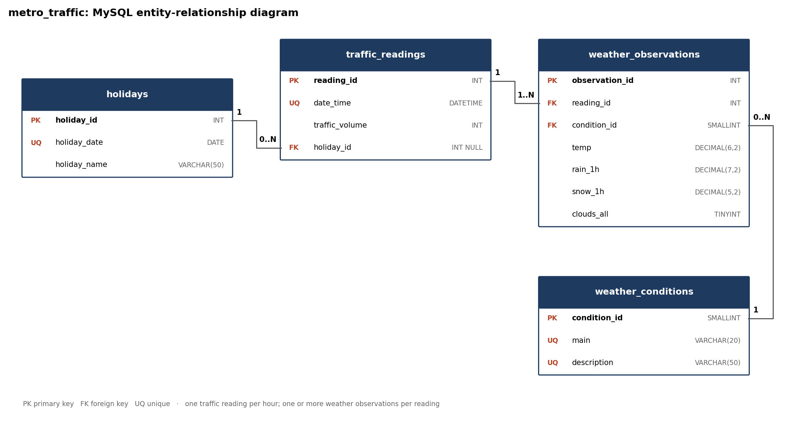

# Time-Series Pipeline — Metro Interstate Traffic Volume (Group 21)

A pipeline for forecasting **hourly traffic on Interstate 94** (Minneapolis–St Paul): exploratory analysis and preprocessing → model training → MySQL and MongoDB storage → a CRUD / time-series API → a prediction script.

## Problem definition
Forecast the **hourly westbound traffic volume** on I-94 at MnDOT ATR station 301. The target is `traffic_volume` (vehicles per hour). The task is a **one-step-ahead regression forecast**: given the traffic history up to hour *t-1*, the calendar and the weather, predict the volume for hour *t*. Short-term traffic forecasts feed ramp metering, incident response, roadwork scheduling and congestion alerts.

## Dataset and why we chose it
[Metro Interstate Traffic Volume](https://www.kaggle.com/datasets/pooriamst/metro-interstate-traffic-volume) (Kaggle; originally UCI ML Repository #492, CC BY 4.0) — 48,204 rows.

| Requirement | How the dataset meets it |
|---|---|
| Clear timestamp | `date_time`, hourly, 2012-10-02 09:00 → 2018-09-30 23:00 |
| Meaningful target | `traffic_volume`, vehicles per hour (0–7,280) |
| Several variables over time | temperature, rain, snow, cloud cover, weather category, holiday |

It also has realistic data problems to solve: duplicate timestamps, 22.8% missing hours (including a 10-month outage) and impossible sensor values.

---

## Task 1A — Understanding the dataset
Notebook: [`notebooks/01_eda_preprocessing.ipynb`](notebooks/01_eda_preprocessing.ipynb)

* **Time range:** 2 Oct 2012 – 30 Sep 2018 (≈ 6 years). **Granularity:** hourly.
* **Duplicates:** 7,629 rows share a timestamp. Traffic is identical within each hour; only the weather condition differs. They are collapsed to one row per hour, keeping the most severe condition.
* **Missing values:** 11,976 of 52,551 expected hours (22.8%) are missing. Most gaps are 1 hour; one outage runs from 8 Aug 2014 to 11 Jun 2015.

| Problem | Method | Why |
|---|---|---|
| Holiday only labelled at 00:00 | Spread to all 24 hours of the date, add `is_holiday` | A holiday is a property of the day |
| Gaps ≤ 3 h | Time-based linear interpolation, flagged `is_imputed` | Traffic changes smoothly over 1–3 h; keeps lag features correct |
| Gaps > 3 h (incl. the 10-month outage) | Not filled; affected lag windows dropped | Filling would invent daily and weekly cycles |
| 0 K temperatures, 9,831 mm rain | Set to NaN, then handled as missing | Physically impossible readings |

* **Distributions:** traffic is bimodal (night ≈ 300–1,000, day ≈ 4,500–6,000 vehicles/h); rain and snow are zero-inflated and heavily skewed; cloud cover is U-shaped.

The cleaning code is in [`src/preprocessing.py`](src/preprocessing.py) so later stages (training, prediction) can reuse exactly the same steps.

## Task 1B — Analytical questions
Each question has at least one chart (in [`outputs/figures/`](outputs/figures/)) and an interpretation in the notebook. **Q1, Q3 and Q6 use moving averages and/or lagged features.**

| # | Question | Main finding |
|---|---|---|
| Q1 | Is there a long-term trend? *(7/30/365-day moving averages)* | No meaningful trend (+0.44%/year, p = 0.055); strong seasonality |
| Q2 | What daily and weekly patterns exist? | Weekday peaks at 07:00 and 16:00; weekends 26% lower |
| Q3 | Are there lag effects? *(lagged features, ACF/PACF)* | Lag 168 h r = 0.946 (strongest), lag 1 h r = 0.915 |
| Q4 | Do weather variables correlate with traffic? | Snow cuts rush-hour traffic by 12%; other weather effects are small |
| Q5 | How do holidays change traffic? | −27% on average; up to −49% on Christmas / New Year |
| Q6 | Do moving averages show whether this hour will be above or below last week? *(lags + moving averages)* | Yes, r = 0.47; MA-adjusted weekly forecast is 6.4% more accurate |

---

## Task 2 — Databases (MySQL and MongoDB)
Both databases hold the **raw recorded values** (not the cleaned features). Cleaning stays in `src/preprocessing.py`, so the Task 4 script can fetch raw records from the API and preprocess them exactly like the training data.

**Why the raw CSV is split up:** it has 48,204 rows for 40,575 hours, because an hour is repeated once per weather condition (e.g. "Rain" + "Mist"). Traffic is counted once per hour, but the weather can be reported several times. Storing both in one table would duplicate the traffic count.

### MySQL schema (4 tables) — [`database/mysql/schema.sql`](database/mysql/schema.sql)



| Table | Rows | Purpose |
|---|---:|---|
| `holidays` | 53 | One row per holiday date. The source labels only the 00:00 row; every hour of that date links here. |
| `weather_conditions` | 37 | Lookup of (`main`, `description`) pairs, e.g. (Rain, light rain). |
| `traffic_readings` | 40,575 | **The time series**: one row per hour, `date_time` is `UNIQUE` (also the index for latest / date-range queries). |
| `weather_observations` | 48,187 | Weather reports within an hour (1–n per reading): temp, rain, snow, clouds. |

* Foreign keys: `traffic_readings.holiday_id → holidays` (`ON DELETE SET NULL`), `weather_observations.reading_id → traffic_readings` (`ON DELETE CASCADE`), `weather_observations.condition_id → weather_conditions`.
* `CHECK` constraints reject impossible values (negative rain, clouds > 100%, temperature below 0 K).
* View **`v_hourly_readings`** returns one row per hour in the same shape as the MongoDB documents and API records (weather averaged over the hour, conditions as a JSON array).
* Loading notes: 17 exact duplicate rows are removed; descriptions are lower-cased because the source spells the same condition "Sky is Clear" and "sky is clear".

### MongoDB collection design — `metro_traffic.traffic_readings`
One document per hour. Weather conditions are **embedded** as an array because they are always read together with their hour and there are only 1–3 per hour; holiday is a plain field. The shape matches what `preprocessing.records_to_raw_frame()` expects.

```json
{
  "_id": ObjectId("..."),
  "date_time": ISODate("2012-10-14T09:00:00Z"),
  "traffic_volume": 2685,
  "holiday": null,
  "temp": 282.43, "rain_1h": 0.0, "snow_1h": 0.0, "clouds_all": 57,
  "weather": [
    {"main": "Drizzle", "description": "light intensity drizzle"},
    {"main": "Haze",    "description": "haze"},
    {"main": "Mist",    "description": "mist"}
  ],
  "source": "csv_import"
}
```

* **Validation:** `$jsonSchema` validator — [`database/mongodb/validator.json`](database/mongodb/validator.json) (required fields, types, value ranges).
* **Indexes:** `date_time` unique · `weather.main` + `date_time` (multikey) · `holiday` (partial, holiday documents only).
* **Sample documents:** [`database/mongodb/sample_documents.json`](database/mongodb/sample_documents.json) — an ordinary hour, a holiday, an hour with three conditions, and the last record.
* `date_time` is stored as the local wall-clock time; BSON shows it with a `Z`, but no time-zone conversion is applied.

### Queries and results
Five matching queries per database — SQL in [`database/mysql/queries.sql`](database/mysql/queries.sql), MongoDB in [`database/mongodb/queries.py`](database/mongodb/queries.py). Full code and result tables: [`outputs/query_results/QUERY_RESULTS.md`](outputs/query_results/QUERY_RESULTS.md).

| # | Question | Result |
|---|---|---|
| Q1 | Latest record (5 most recent hours) | Last reading 30 Sep 2018 23:00, 954 vehicles, overcast |
| Q2 | Records by date range (24–30 Sep 2018, daily totals) | Weekdays 82–93k vehicles/day; Sunday lowest at 60,103 |
| Q3 | Weekday rush-hour traffic by weather | Clouds/clear ≈ 6,050 vehicles/h; snow lowest at ≈ 5,430 (−10%) |
| Q4 | Holidays vs ordinary weekdays (complete days only) | Weekday avg 86,572/day; Christmas 45,600 (−47%) and New Year 43,996 (−49%); State Fair higher at 91,280 |
| Q5 | Lag-1, lag-24 and 24-h moving average (window functions) | MySQL `LAG`/`AVG OVER` and MongoDB `$setWindowFields` give identical values |

The two databases return the same answers; a few averages differ by 1 because MongoDB's `$round` rounds halves to even.

### Running Task 2
```bash
cp .env.example .env                                  # then set MYSQL_PASSWORD
mysql -u root -p < database/mysql/schema.sql          # create database, tables, view
python -m scripts.load_mysql                          # load MySQL
python -m scripts.load_mongodb                        # create collection + indexes, load MongoDB
python -m scripts.run_queries                         # run all queries, save results
python -m database.draw_erd                           # redraw the ERD
```
The MySQL user in `.env` needs privileges on `metro_traffic`, e.g.
`CREATE USER 'traffic_user'@'localhost' IDENTIFIED BY '...'; GRANT ALL ON metro_traffic.* TO 'traffic_user'@'localhost';`

---

## Repository structure (current)
```
├── data/
│   ├── raw/Metro_Interstate_Traffic_Volume.csv.gz      original dataset
│   └── processed/traffic_hourly_clean.csv.gz           cleaned, feature-ready data (written by notebook 01)
├── database/
│   ├── mysql/schema.sql                                Task 2: tables, keys, constraints, view
│   ├── mysql/queries.sql                               Task 2: SQL queries
│   ├── mongodb/validator.json                          Task 2: collection $jsonSchema
│   ├── mongodb/sample_documents.json                   Task 2: real sample documents
│   ├── mongodb/queries.py                              Task 2: MongoDB queries
│   ├── erd.png                                         Task 2: ERD
│   └── draw_erd.py                                     draws erd.png
├── notebooks/01_eda_preprocessing.ipynb                Task 1A/B
├── scripts/
│   ├── load_mysql.py                                   Task 2: load MySQL
│   ├── load_mongodb.py                                 Task 2: create + load MongoDB collection
│   └── run_queries.py                                  Task 2: run queries, save results
├── src/
│   ├── preprocessing.py                                cleaning + feature pipeline
│   ├── db.py                                           database connections + raw-to-table split
│   ├── plotting.py                                     chart style
│   └── config.py                                       project paths and settings
└── outputs/
    ├── figures/                                        EDA charts
    └── query_results/                                  Task 2 query results
```

## Running it
```bash
pip install -r requirements.txt
```
```bash
jupyter nbconvert --to notebook --execute --inplace notebooks/01_eda_preprocessing.ipynb
```

## Project parts

| Part | Status |
|---|---|
| Task 1A/B — EDA, preprocessing, analytical questions |  in this repository |
| Task 1C — Model training and experiments | to be added |
| Task 2 — SQL and MongoDB databases | in this repository |
| Task 3 — CRUD and time-series API | to be added |
| Task 4 — Prediction script | to be added |

## Data source
Hogue, J. (2019). *Metro Interstate Traffic Volume* [Dataset]. UCI Machine Learning Repository. https://doi.org/10.24432/C5X60B — CC BY 4.0.
